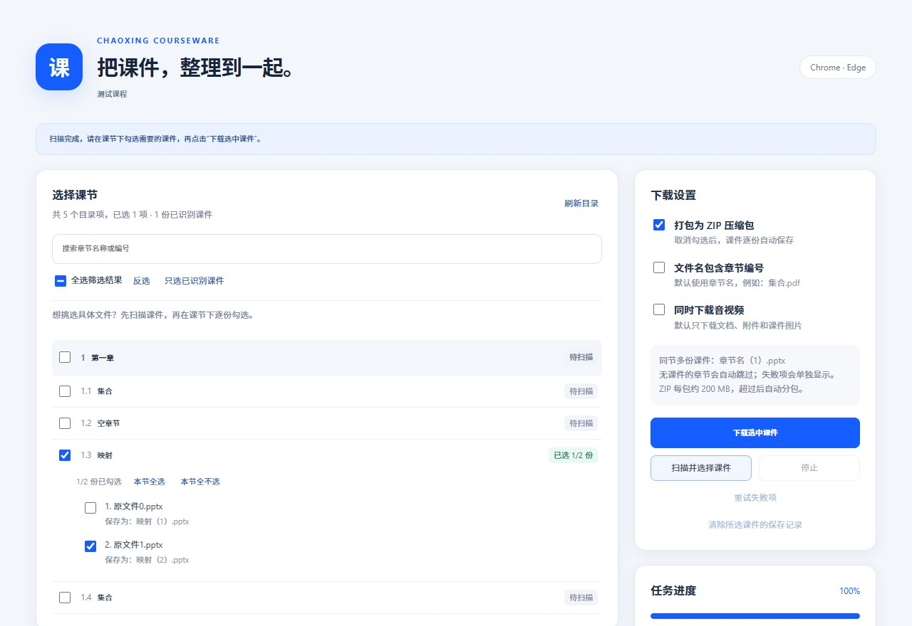

# 超星课件下载

在学习通打开课程，勾选几节课，就能把需要的课件一次下载。支持 Chrome 和 Edge。

[下载 Windows 安装器](https://github.com/makelifeasier/chaoxing-courseware/raw/refs/heads/main/installer/ChaoxingCoursewareSetup.exe) · [下载 ZIP](https://github.com/makelifeasier/chaoxing-courseware/archive/refs/heads/main.zip) · [安装步骤](#安装)

*演示使用测试课程。*

| 想做什么 | 怎么操作 |
| --- | --- |
| 一次下载几节课 | 搜索或勾选课节，空章节会自动跳过 |
| 一节有多份，只要其中几份 | 先扫描，再按原文件名勾选。下载使用这份清单 |
| 下载后好找 | 用章节名保存。同一节的多份文件会保留编号，例如 `映射（2）.pptx` |
| 一次带走整批文件 | 勾选 ZIP 打包，压缩包里只放已选课件 |
| 有文件失败，或者中途关了页面 | 查看每份文件的结果，重试失败项，或重新打开同一课程继续下载。已保存的文件会跳过 |

## 安装

**Windows 安装器**

1. 下载并打开安装器，勾选 Edge、Chrome 或两者，点击「准备安装」。它会解压扩展、复制文件夹路径，并打开对应的扩展管理页。
2. 在每个浏览器开启开发人员模式，点「加载解压缩的扩展」，粘贴路径并选定文件夹。以前用同一安装器装过的，在扩展页点「重新加载」即可。
3. 浏览器显示扩展后，回到安装器点「已完成安装」。如果勾选了清理，这时只会删除安装器文件。

安装器无需管理员权限，扩展保存到当前用户的应用数据目录。安装器暂未签名。可查看或自行编译 [安装器源码](installer/Program.cs) 和 [构建脚本](installer/build.ps1)。

SHA-256：`4789E0295E9C272BD3993152E795D9B7FF53FB4337AAAE358B631F0BFB5471EC`

**ZIP 手动安装**

1. 下载上方的 ZIP 并解压。
2. 在 Chrome 打开 `chrome://extensions/`，或在 Edge 打开 `edge://extensions/`。
3. 开启开发者模式，点击「加载已解压的扩展」，选择解压目录里的 `extension` 文件夹。
4. 登录学习通，打开课程章节页并刷新。点击页面上的「课件批量下载」，也可以从浏览器工具栏打开扩展。

## 使用

勾选课节，点击「扫描并选择课件」。每节下面会列出找到的文件。取消勾选不需要的文件，点击「下载选中课件」。文件默认按章节名保存，同节多份文件会加序号。

「扫描并选择课件」会直接显示已有结果，只扫描还没有清单的课节。想检查课程是否新增课件，点「重新扫描」。首次扫描最多并行处理 6 个课节，每节可同时读取两张内容卡片。

「显示音视频」默认关闭。扫描后打开它即可看到音视频和预览按钮，音视频需要逐份勾选才会下载。旧版保存过的清单如果没有音视频信息，首次需要重新扫描。

每份课件可以单独选「章节名」或「原名」。逐份下载和 ZIP 都使用选定的名字。视频名称末尾的「视频」标记会自动去掉。

下载位置在浏览器的默认下载目录下，路径为「超星课件 / 课程名」。取消「打包为 ZIP 压缩包」即可逐份保存。没有课件的章节会自动跳过。

勾选「按类型分包」后，PDF、音视频和其他课件各自生成 ZIP。空的类别不会生成压缩包。

点文件旁的「预览」可以查看 PDF、图片、浏览器支持的音视频，以及原站提供了 PDF 预览的 Office 文件。音视频按需加载。再次打开最近预览的小型 PDF 时会复用内存中的文件。预览窗口里可以直接勾选或取消下载。

## 更新

打开面板时会检查版本，检查结果在本地保留一天。面板底部也可以手动检查。有新版时，按提示下载安装包，覆盖原文件夹，然后在浏览器的扩展管理页点「重新加载」。

文件旁会显示保存结果。点「重试失败项」可重试勾选的失败文件，ZIP 模式会生成补充包。重新打开同一课程的下载面板可继续处理剩余文件，尚未保存的 ZIP 需要重新打包。

## 权限和数据

扩展使用浏览器里已有的学习通登录状态，访问超星课程页和 cldisk 文件服务器。课件清单、勾选和保存记录存在当前浏览器。更新检查只读取本仓库公开的版本文件，不发送学习通登录信息、课程地址或课件记录。

## 测试

有 Node.js 时，在仓库根目录运行 `npm ci` 和 `npm test`。运行浏览器测试前，用 `npx playwright install chromium` 安装 Chromium，并准备本机 Edge，再运行 `npm run test:browser`。

## 许可

项目使用 GPL-3.0-or-later。JSZip 使用 MIT 许可，详见扩展目录的 `vendor` 文件夹。实现参考了 [超星学习通章节资源直链下载（融合版）](https://github.com/KenXK/ChaoxingDownload_FusionEdition) 的资源读取方式。
